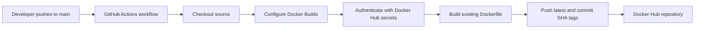

# House Price Prediction System

## Aim

Continue the existing House Price Prediction project with a user-friendly
Streamlit interface and portable Docker deployment. The interface reuses
`house_price_model.pkl`; it does not train or create another model.

## Project description

The existing Linear Regression model predicts house prices in lakhs using
three features: area in square feet, number of bedrooms, and house age in
years. `streamlit_app.py` loads the saved model, accepts property details,
and displays a formatted prediction.

The original Flask REST API (`app.py`) and model training script
(`train_model.py`) remain in the project. The Docker image runs the Streamlit
interface directly.

## Technologies

- Python 3.11 (Docker image; Python 3.9 or later recommended locally)
- Streamlit
- scikit-learn
- NumPy
- Joblib
- Docker

## Project structure

```text
ml-flask-api/
├── app.py                    # Existing Flask API
├── train_model.py            # Existing model training script
├── house_price_model.pkl     # Existing trained model used by Streamlit
├── streamlit_app.py          # New web interface
├── requirements.txt          # Streamlit application dependencies
├── Dockerfile                # Docker image instructions
├── .dockerignore             # Files excluded from Docker build context
└── README.md
```

## Install and run locally

Open a terminal in this project folder. On Windows, create and activate a
virtual environment, then install the dependencies:

```powershell
python -m venv venv
venv\Scripts\activate
pip install -r requirements.txt
```

Start the application:

```powershell
streamlit run streamlit_app.py
```

Open <http://localhost:8501> in a browser. The saved model must remain in the
project folder next to `streamlit_app.py`. No model training is needed.

## Test the Streamlit application

Enter values in the three input fields and select **Predict House Price**.
The result is displayed as `Predicted House Price: ₹ XX.XX Lakhs`.

With the existing sample model, these inputs produce:

| Area (sq ft) | Bedrooms | Age (years) | Predicted price (lakhs) |
|---:|---:|---:|---:|
| 2000 | 3 | 5 | 55.13 |
| 1000 | 2 | 5 | 33.13 |
| 2500 | 4 | 8 | 65.63 |
| 3000 | 4 | 3 | 78.13 |

These are predictions from the existing trained model, not newly trained
values.

## Build the Docker image

Install and start Docker Desktop first. From the project folder, run:

```powershell
docker build -t house-price-streamlit .
```

`docker build` creates an image, `-t house-price-streamlit` gives it a
readable name, and `.` uses the current project folder as the build context.
The Dockerfile installs `requirements.txt`, copies the existing model and
application files into the image, and configures Streamlit on port 8501.

List available images:

```powershell
docker images
```

## Run and manage the Docker container

Start the application in the background and publish its port:

```powershell
docker run -d -p 8501:8501 --name house-price-app house-price-streamlit
```

`-d` runs in the background, `-p 8501:8501` maps host port 8501 to container
port 8501, `--name` assigns a convenient container name, and the final value
selects the image to run. Open <http://localhost:8501>.

List running containers:

```powershell
docker ps
```

Stop and remove the container when finished:

```powershell
docker stop house-price-app
docker rm house-price-app
```

To test in the container, enter `Area: 2000`, `Bedrooms: 3`, and
`Age: 5`, then select **Predict House Price**. The result should be
`₹ 55.13 Lakhs`. The other test cases are listed in the table above.

## Push the project to GitHub

Create an empty repository on GitHub and copy its repository URL. In a
terminal opened in the project folder, run:

```powershell
git init
git add .
git commit -m "Added Streamlit UI and Docker deployment"
git branch -M main
git remote add origin YOUR_GITHUB_REPOSITORY_URL
git push -u origin main
```

Replace `YOUR_GITHUB_REPOSITORY_URL` with the URL of your own GitHub
repository; do not use the placeholder literally. If this folder is already
a Git repository, do not run `git init` or add a second `origin`; use the
appropriate existing remote instead.

## Push the Docker image to Docker Hub

Create a Docker Hub account, then authenticate in the terminal:

```powershell
docker login
```

Tag and push the image:

```powershell
docker tag house-price-streamlit YOUR_DOCKERHUB_USERNAME/house-price-streamlit:latest
docker push YOUR_DOCKERHUB_USERNAME/house-price-streamlit:latest
```

Replace `YOUR_DOCKERHUB_USERNAME` in both commands with your actual Docker
Hub username.

## College laboratory execution checklist

1. Open this folder in VS Code and open its terminal.
2. Create/activate the virtual environment and install dependencies.
3. Run `streamlit run streamlit_app.py`.
4. Browse to <http://localhost:8501> and test the sample property inputs.
5. Start Docker Desktop, build the image, and run the container with the
   commands above.
6. Browse to <http://localhost:8501> again and test the prediction in Docker.
7. Optionally publish the project to GitHub and the image to Docker Hub.

## CI/CD pipeline using GitHub Actions

### Aim and objectives

Automatically build and publish the existing Streamlit Docker application
when changes are pushed to the GitHub `main` branch. The workflow publishes
both `latest` and the full Git commit SHA as image tags, and also supports
manual execution from GitHub Actions.

### Technologies

GitHub, GitHub Actions, GitHub Actions YAML, Docker, Docker Buildx, Docker
Hub, and the project's existing Dockerfile.

### CI/CD architecture



### Workflow file and stages

The workflow is
`.github/workflows/docker-build-push.yml`. It runs on every push to `main`
and can also be started with **Actions → Docker build and push → Run
workflow**. It checks out the source, checks that both required secrets are
present without printing their values, sets up Buildx, logs in to Docker Hub,
and builds the root `Dockerfile`. The built image is pushed with these tags:

```text
YOUR_DOCKERHUB_USERNAME/house-price-streamlit:latest
YOUR_DOCKERHUB_USERNAME/house-price-streamlit:<full Git commit SHA>
```

The username in the tags comes from `DOCKERHUB_USERNAME`; the token is
provided as the login password from `DOCKERHUB_TOKEN`. Neither credential is
stored in the workflow source.

### Prepare Docker Hub

1. Sign in to Docker Hub or create an account.
2. Create a repository named `house-price-streamlit`. Select public or
   private visibility according to your needs.
3. In Docker Hub account settings, open **Personal access tokens** and
   generate a token with read and write permissions. Copy it when generated
   and store it securely; do not put it in project files or share it.

### Configure GitHub repository secrets

In the GitHub repository, open **Settings → Secrets and variables →
Actions → New repository secret** and add:

| Secret name | Secret value |
|---|---|
| `DOCKERHUB_USERNAME` | Your actual Docker Hub username |
| `DOCKERHUB_TOKEN` | The Docker Hub access token created above |

Save each secret. GitHub Actions masks configured secrets in logs; do not
print, hardcode, commit, or paste the token into workflow YAML.

### Connect and push the existing project

The project folder must be the repository root so the workflow can find
`Dockerfile`, `requirements.txt`, `streamlit_app.py`, and
`house_price_model.pkl`. In a terminal opened in `ml-flask-api`, inspect the
Git state:

```powershell
git status
git remote -v
```

If Git is not initialized, initialize it. Then add and commit the project,
including the workflow file:

```powershell
git init
git add .
git commit -m "Added automated CI CD pipeline"
git branch -M main
```

Only run `git init` when this folder is not already a repository. If there
is no `origin` remote, create a GitHub repository and add its actual URL:

```powershell
git remote add origin YOUR_GITHUB_REPOSITORY_URL
```

Replace the placeholder with your own GitHub repository URL; no URL is
provided here. If a remote already exists, do not add a duplicate; verify
that it points to the intended repository. Push the `main` branch:

```powershell
git push -u origin main
```

### Trigger and verify automatic deployment

After the workflow is committed, pushed to `main`, and both GitHub secrets
are configured, each subsequent push to `main` starts the workflow. To test
it, make a small harmless UI text change in `streamlit_app.py`, then run:

```powershell
git add .
git commit -m "Test automated Docker deployment"
git push origin main
```

No local image build or manual image push is needed for this CI/CD test.
Open the repository's **Actions** tab, open **Docker build and push**, and
check each step for a green success indicator. The manual
`workflow_dispatch` trigger is also available on the workflow page.

### Verify the Docker Hub images

Open the `house-price-streamlit` repository on Docker Hub and verify that
both `latest` and the tag matching the successful workflow's full commit
SHA are listed. Confirm the latest tag's update time matches the recent
push. Pull and run the published image (replace the username placeholder):

```powershell
docker pull YOUR_DOCKERHUB_USERNAME/house-price-streamlit:latest
docker run -d -p 8501:8501 --name house-price-app YOUR_DOCKERHUB_USERNAME/house-price-streamlit:latest
```

Open <http://localhost:8501> and make a prediction to verify the pulled
container. If `house-price-app` already exists, stop and remove that
container before reusing its name:

```powershell
docker stop house-price-app
docker rm house-price-app
```

### Troubleshooting

| Problem | Resolution |
|---|---|
| Missing GitHub secrets | Add both exact names under repository **Settings → Secrets and variables → Actions**, then rerun the workflow. |
| Invalid Docker Hub credentials | Generate a new Docker Hub access token with write access and update `DOCKERHUB_TOKEN`. |
| Incorrect Docker Hub username | Set `DOCKERHUB_USERNAME` to the account username (not an email address) that owns the repository. |
| Incorrect image/repository name | Create or select `house-price-streamlit` on Docker Hub and keep the workflow image path unchanged. |
| Missing Dockerfile/build failure | Ensure the root `Dockerfile`, `requirements.txt`, Streamlit file, and model artifact are committed; inspect the failed build log in Actions. |
| Workflow YAML error | Keep the workflow at `.github/workflows/docker-build-push.yml`; check indentation and the Actions error details. |
| Wrong branch | The automatic trigger is only for `main`; push to `main` or manually run the workflow from the Actions page. |
| No workflow run after push | Confirm the workflow file is committed on GitHub, the push targeted `main`, and Actions are enabled for the repository. |

### Expected result

After the workflow, Docker Hub secrets, and repository are configured, each
push to `main` should build the existing Streamlit Docker application and
publish both `latest` and commit-SHA tags. The workflow's successful run and
the updated tags in Docker Hub are the evidence that the deployment worked.
